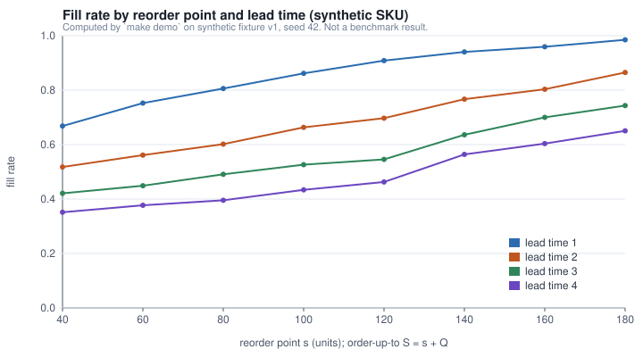

# demand-inventory-lab

An inventory planner needs to know what happens to service level and holding cost when
demand or lead time changes. This repository backtests three demand-forecasting
baselines with a rolling origin and runs a deterministic replenishment simulator over a
reorder-point by lead-time scenario grid, all on authored synthetic data.

**Status:** `demo_ready` (runs end to end on authored synthetic fixtures; no real-data
evaluation performed in this repository).

Project type: `original_project`. No publication, client or real company is associated
with this code.

## Problem and user

The user is an inventory planner choosing a reorder point and order-up-to level for a
SKU under uncertain demand and uncertain supplier lead time. Two questions drive the
design:

1. How well can demand be forecast at horizons 1 to 6, and how wide should the
   uncertainty band be?
2. Given a forecast error of that size, what service level and holding cost result from
   each (reorder point, lead time) pair, and what does a demand shock do to them?

The forecasting layer answers the first question with an honest backtest. The
simulator answers the second with a period-by-period ledger whose balance identity is
tested on every row.

## Demo

```
make smoke      # about 20 s: coarse backtest + small scenario grid, schema-checked
make demo       # about 2 to 3 min: full backtest, forecast, 32-cell grid, 4 SVG figures
```

`make demo` writes `examples/output/`:

| File | Content |
|---|---|
| `backtest_records.csv` | one row per (model, origin, horizon): actual, forecast, interval bounds, residual pool size, MASE denominator |
| `backtest_summary.json` | MAE, WAPE, MASE, 80% interval coverage per model, overall and by horizon |
| `forecast.json` | six-step forecast with intervals from the last observation |
| `scenario_grid.json` | `{schemaVersion, mode: "synthetic-demo", grid: [...]}` for the portfolio warehouse scene |
| `shock_comparison.json` | one policy with and without a demand shock |
| `run_manifest.yaml` | run id, fixture hashes, configuration hash, seed, environment |

Figures in `docs/figures/` are rendered from those files by `tools/render_figures.py`.



## Implementation status

Works:

- `census/`: MRTS query builder, response parser, on-disk cache with retrieval date,
  payload SHA-256 and a data-vintage note. Network access lives behind one transport
  function; tests use a fake transport. `make fetch` prints the Census terms of service
  URL before anything else and is never run in CI.
- `forecast/`: seasonal naive, Holt-Winters (statsmodels, additive, damped trend), and a
  direct multi-horizon HistGradientBoosting forecaster on lag features whose transforms
  are fitted on the training window only. Rolling-origin backtest with horizons 1 to 6.
  Metrics: MAE, WAPE (undefined when actuals sum to zero), MASE with an explicit
  seasonal-naive denominator, and interval coverage. MAPE is not a default metric; the
  reason is in `docs/method.md`.
- `inventory/`: (s, S) and (s, Q) periodic-review simulator with fixed or distributed
  lead time, safety-stock helper, demand shock injection, lost-sales or backorder mode,
  and cost accounting from `configs/assumptions.yaml`. Deterministic by seed.
- CLI: `python -m demand_inventory_lab {smoke,demo,backtest,simulate,evaluate,figures,fetch}`.

Stub or proposed: nothing is stubbed. Not implemented and not claimed: probabilistic
lead-time forecasting, multi-echelon networks, price or promotion effects, and any
calibration to a real supply chain.

## Quickstart (offline, CPU, under a minute)

```
python -m pip install -e .
python -m pip install pytest
make smoke
make test
```

## Data

See `DATA_CARD.md`. Two independent synthetic fixtures ship in `examples/fixtures/v1/`
(`FIXTURE.md` describes both):

- `mrts_synthetic.csv`: an MRTS-shaped monthly table with three fictional category
  codes, 10 years, seasonality + trend + noise, from `tools/make_fixture.py` seed 42.
- `sku_demand.csv`: weekly integer demand for 12 fictional SKUs at 2 fictional stores,
  104 weeks, from `tools/make_sku_fixture.py` seed 42.

Real aggregate data can be fetched from the US Census Monthly Retail Trade Survey API
with `make fetch` (terms URL printed first; key optional via `CENSUS_API_KEY`). No Census
rows are shipped. **Aggregate Census data is never blended with the SKU simulation**:
the forecasting layer may run on a Census series, the simulator runs only on SKU-level
synthetic demand, and no code path passes one to the other.

## Architecture / method

```
tools/make_fixture.py ----> examples/fixtures/v1/mrts_synthetic.csv
                                     |
                       forecast.backtest.rolling_origin_backtest
                       (seasonal naive | Holt-Winters | lag GBM)
                                     |
                 backtest_records.csv / backtest_summary.json / forecast.json

tools/make_sku_fixture.py -> examples/fixtures/v1/sku_demand.csv
                                     |
                       inventory.scenarios.run_scenario_grid
                       (simulate() per reorder point x lead time)
                                     |
                       scenario_grid.json / shock_comparison.json
```

Details, including the point-in-time interval construction and the event order inside
a simulated period, are in `docs/method.md`.

## Train, validate, test

There is no train/validation/test split in the classification sense. The forecasting
protocol is a rolling origin: for each origin `o`, models see `y[:o]` and are scored on
`y[o:o+6]`. Intervals at origin `o` use only residuals whose target date is before `o`.
The GBM's level normalisation and target scaler are fitted per fold on the training
window only, and a test perturbs post-window values to prove the fitted statistics do
not move. The simulator has no fitted parameters.

## Results and provenance

Evidence label for everything in this repository: `demo`. The values below were
computed by `make demo` on synthetic fixture v1, seed 42, and are not a benchmark
result. They describe the authored fixture, not any real market or product.

Backtest, series `SYN-RET-01`, 36 origins (every second month from month 48), 210
forecasts per model:

| model | MAE | WAPE | MASE | 80% interval coverage (n=156 with an interval) |
|---|---|---|---|---|
| seasonal_naive | 516.9 | 0.035 | 1.034 | 0.718 |
| holt_winters | 400.2 | 0.027 | 0.799 | 0.699 |
| lag_gbm | 378.1 | 0.025 | 0.756 | 0.705 |

Coverage of the nominal 80% intervals is about 0.70 for all three models: the residual
pools are small (8 to 36 residuals per horizon) and the fixture has a growing level, so
the empirical bands lag the trend. That is a limitation of the interval method, and it
is reported rather than tuned away.

Scenario grid, `SYN-SKU-0001` at `SYN-STORE-01`, 104 weeks, Q = 120, lost-sales mode,
costs from `configs/assumptions.yaml`: fill rate rises from 0.668 to 0.985 as the
reorder point moves from 40 to 180 at lead time 1, while holding cost rises from 173.5
to 614.9 abstract currency units. At lead time 4 the same reorder points give fill
rates 0.351 to 0.650. A 1.5x demand shock over weeks 60 to 67 with s = 120, S = 240,
lead time 1 lowers fill rate from 0.909 to 0.876 and raises stockout cost from 2668 to
3796.

Nothing here is `reproduced` or `paper-reported`; there is no source paper.

## Limitations

- Synthetic data only. The fixtures were authored to exercise the code, and the metric
  values say nothing about forecast accuracy on real demand.
- Interval coverage is below nominal on the fixture (see above). A user should check
  coverage on their own history before trusting the bands.
- The simulator assumes demand is exogenous, lead times are independent draws, and
  costs are linear. Lost-sales mode discards unmet demand; backorder mode fills it later
  but the fill rate reported is immediate fill only.
- The Census client has been exercised against a fake transport only. The endpoint
  parameters follow the public documentation but were not verified against the live API
  in this repository.
- Holt-Winters uses statsmodels' default optimiser; convergence warnings are suppressed
  and a degenerate fit raises rather than returning a silent constant.

## Contribution

Original project by Md Sultanul Arefin Sourav. Business analytics research with an
academic affiliation to Trine University. This repository does not implement or claim
any publication.

## License and sources

MIT License, copyright 2026 Md Sultanul Arefin Sourav. See `LICENSE`, `NOTICE.md` and
`CITATION.cff`. Census data, when fetched, is subject to the US Census Bureau terms of
service at https://www.census.gov/data/developers/about/terms-of-service.html and is not
redistributed here.
