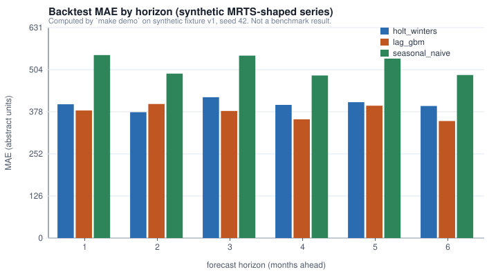
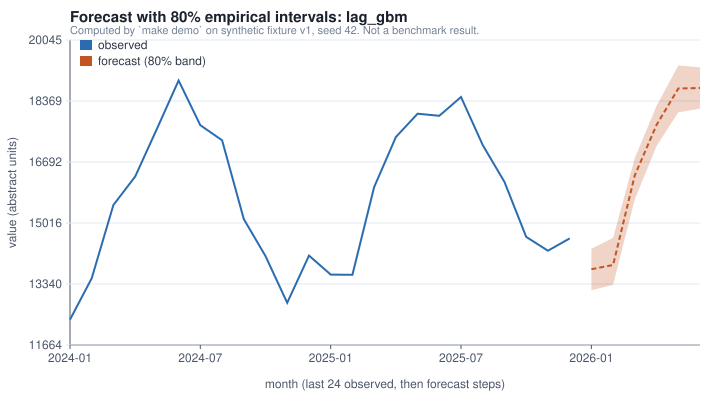
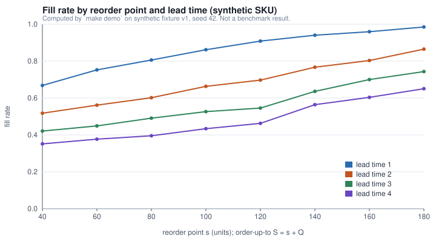
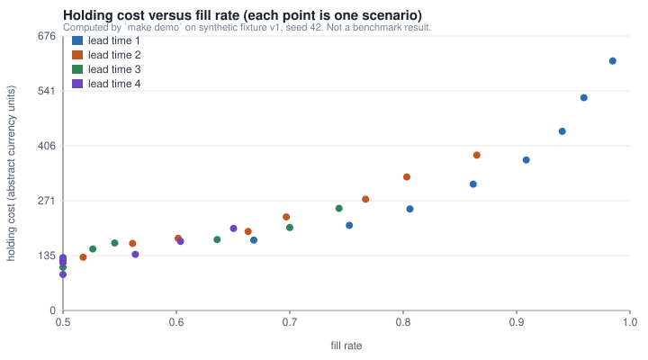

# Evaluation

Everything on this page carries the evidence label `demo`: computed by `make demo` on
synthetic fixture v1, seed 42, not a benchmark result. The fixture was authored to
exercise the code; the numbers describe the fixture, not any real demand series or
product.

## Protocol

- Series: `SYN-RET-01` from `examples/fixtures/v1/mrts_synthetic.csv`, 120 monthly
  observations.
- Rolling origin from month 48, step 2, so 36 origins; horizons 1 to 6, clipped at the
  series end; 210 forecasts per model.
- Models fitted on `y[:o]` only at each origin. GBM transforms fitted on the training
  window only.
- 80% intervals from earlier out-of-sample residuals per horizon whose target index is
  below the origin; reported only once 8 residuals exist (156 of 210 rows have one).
- Metrics: MAE, WAPE, MASE (per-fold seasonal-naive denominator), interval coverage.
  MAPE is not reported; see `docs/method.md` section 3.

## Backtest summary (`examples/output/backtest_summary.json`)

| model | n | MAE | WAPE | MASE | mean MASE denominator | 80% coverage | rows with interval |
|---|---|---|---|---|---|---|---|
| seasonal_naive | 210 | 516.88 | 0.0347 | 1.034 | 501.34 | 0.718 | 156 |
| holt_winters | 210 | 400.15 | 0.0268 | 0.799 | 501.34 | 0.699 | 156 |
| lag_gbm | 210 | 378.12 | 0.0254 | 0.756 | 501.34 | 0.705 | 156 |

MAE by horizon:

| model | h=1 | h=2 | h=3 | h=4 | h=5 | h=6 |
|---|---|---|---|---|---|---|
| seasonal_naive | 548.3 | 492.7 | 546.6 | 487.0 | 537.8 | 488.4 |
| holt_winters | 400.8 | 377.1 | 421.9 | 398.9 | 407.1 | 395.8 |
| lag_gbm | 382.3 | 401.7 | 380.8 | 355.7 | 396.6 | 350.5 |

Reading: on this fixture the seasonal naive MASE is about 1.03, as expected for a
seasonal-naive-scaled metric (its out-of-sample error is close to its in-sample error).
Holt-Winters and the lag GBM both beat it. MAE does not grow with horizon here because
the fixture's noise is independent across months and the seasonal structure is strong;
on real data a rising error with horizon is the normal picture.

Interval coverage sits near 0.70 against a nominal 0.80 for all models. The residual
pools hold between 8 and 36 residuals and the fixture's level grows over time, so
quantiles of past residuals under-cover a trending series. This is reported as a
limitation of the empirical interval method rather than adjusted.





## Scenario grid (`examples/output/scenario_grid.json`)

`SYN-SKU-0001` at `SYN-STORE-01`, 104 weeks, (s, S) policy with S = s + 120, weekly
review, lost sales, costs from `configs/assumptions.yaml`. 32 cells. Selected cells:

| reorder point | lead time | fill rate | stockout periods | holding cost | orders |
|---|---|---|---|---|---|
| 40 | 1 | 0.668 | 45 | 173.5 | 32 |
| 100 | 1 | 0.862 | 23 | 311.3 | 39 |
| 180 | 1 | 0.985 | 4 | 614.9 | 43 |
| 40 | 4 | 0.351 | 74 | 88.7 | 17 |
| 100 | 4 | 0.434 | 64 | 124.2 | 19 |
| 180 | 4 | 0.650 | 47 | 202.2 | 31 |

Fill rate is non-decreasing in the reorder point for every lead time (a test checks this
on the fixture) and falls as lead time grows because the protection interval lengthens
while s is held fixed. Holding cost rises with s. The grid does not identify a best
policy; it shows the trade-off surface an inventory planner chooses on.





## Shock comparison (`examples/output/shock_comparison.json`)

s = 120, S = 240, lead time 1, demand x1.5 over weeks 60 to 67:

| | units demanded | fill rate | stockout periods | holding cost | stockout cost | total cost |
|---|---|---|---|---|---|---|
| baseline | 7,291 | 0.909 | 19 | 370.95 | 2,668 | 5,088.95 |
| shocked | 7,678 | 0.876 | 20 | 363.45 | 3,796 | 6,209.45 |

## Local test run (2026-09-27)

```
$ python -m pytest -q
68 passed in 21.51s
```

Run on Python 3.10.11, Windows, CPU. `make smoke` completed in about 20 seconds on the
same machine. The suite covers: no future lags in features, empty and zero series,
seasonal indexing, the inventory balance identity on every period, lead-time boundaries
(0, 1, beyond horizon, distribution), reproducible scenario output, the undefined WAPE
case, the MASE denominator, and that the rolling origin never trains on future values.
